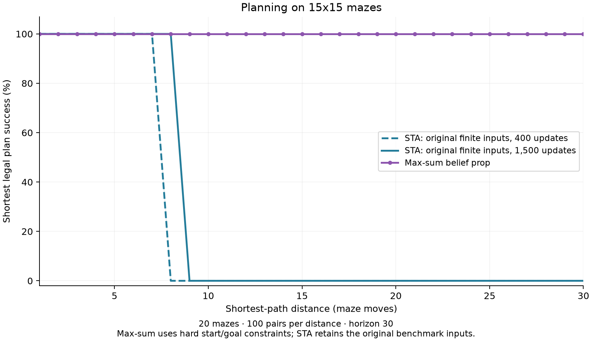

# Planning on 15×15 mazes

A reproducible, noiseless comparison of a block implementation of the handcrafted
spacetime attractor (STA) recurrence and exact max-sum belief propagation with
backtracing. Both methods receive the same 20 mazes and 3,000 start–goal pairs.



**Scope of the comparison.** STA retains finite start inputs, repeated goal rewards,
its numerical floor, and independent time-module decoding. Max-sum uses hard
start/goal/transition constraints, a step cost, and joint backtracing. This is a
comparison on the same planning tasks, **not an experiment isolating the update
rule while holding all factors and decoding fixed**. It is not a reproduction of
a specific figure in the original paper, a parameter sweep, or a claim about all
STA variants. See [METHODS.md](METHODS.md).

## Quick start

The release was tested in a fresh **CPython 3.12, macOS ARM64, CPU-only** virtual
environment. Other platforms have not been validated. PyTorch 2.2.2 and NumPy
1.26.4 are pinned together; use Python 3.12, not the latest Python by default.

```sh
python3.12 -m venv .venv
source .venv/bin/activate
python -m pip install -r requirements.lock
python -m benchmark plot
```

This last command reads the bundled per-query paths, independently recomputes maze
distances, scores **both** methods, and writes PNG/PDF figures and CSV tables to
`figures/`. No planner execution or network access is needed once dependencies
are installed. No plotted success rate is hardcoded.

## Rerun the complete experiment

```sh
python -m benchmark run --output scratch/rerun
python -m benchmark compare --results scratch/rerun --output scratch/comparison.json
python -m benchmark plot --results scratch/rerun --output scratch/figures
```

The first command runs noiseless STA to 1,500 updates, recording the 400-update
checkpoint, and runs max-sum with backtracing. It uses the frozen maze/query inputs
by default. Allow several minutes on a laptop CPU; timing depends on hardware and
load. There is no training or GPU requirement. Results go into a separate output
directory; the original reference arrays remain unchanged. Rerunning this command
recomputes all 20 mazes rather than silently resuming potentially stale outputs.

`compare` reports success-label differences, differing trajectories, and maximum
peak-activity differences. It exits unsuccessfully if scored results differ from
the reference. Floating-point or tie-breaking differences may change a trajectory
without changing whether it is shortest; those differences are still recorded.

## Audit inputs and implementation

```sh
python -m unittest discover -s tests -v
python -m benchmark verify
python -m benchmark generate-inputs --output scratch/regenerated-inputs
```

- Tests execute the **unchanged upstream STA `step` method body** with prepared
  inputs and dense weights and compare it with the block recurrence. This checks
  the recurrent computation, not the entire upstream environment/policy pipeline.
- Max-sum is checked against exhaustive trajectory enumeration on a small graph,
  including start-at-goal and unreachable-goal cases.
- Scoring tests distinguish an illegal shortcut, a legal detour, and a shortest
  goal-reaching prefix. The primary STA score stops at goal arrival.
- `verify` checks SHA-256 hashes and rescores all bundled method/query results.
- `generate-inputs` recreates all maze layouts and query selections from the
  original seeds using the vendored upstream generator and checks exact agreement
  with the frozen inputs. It does not use stored distances to generate mazes.

## Recorded result

There are 100 distinct queries at each distance, distributed across 20 mazes.

| Method | Observed shortest-plan success |
| --- | --- |
| STA, 400 updates | 100% at distances 1–7; 0% at 8–30 |
| STA, 1,500 updates | 100% at distances 1–8; 0% at 9–30 |
| Max-sum with backtracing | 100% at every distance 1–30 |

These are observed rates under the stated settings. The confidence threshold
variant in the trial CSV does not change the STA shortest-plan labels for this
dataset. Results describe complete plans produced before any movement, not
closed-loop navigation with replanning. Earlier approximate runtime comparisons
are not part of this figure's claim.

## Contents and provenance

- `benchmark/`: standalone runner, planners, scorer and plotting code.
- `data/mazes/`: fixed maze layouts, adjacencies, queries and reference distances.
- `results/reference/`: original decoded plans and peak activities, extracted
  without changing their numerical arrays; source-file hashes are recorded.
- `figures/`: figure, rates with bootstrap intervals, and all 9,000 method/query
  scores (3,000 queries × three configurations).
- `vendor/pysta/`: two unmodified upstream source files plus their MIT license.
- `MANIFEST.json`: hashes of the frozen inputs, reference outputs and vendor files.
- `VERIFICATION.md`: checks performed for this local release candidate.

The original implementation is [KrisJensen/pysta](https://github.com/KrisJensen/pysta),
pinned to commit `fdd6dd39df54a67aa451a24d3adc280f25136601`, associated with
[A mechanistic theory of planning in prefrontal cortex](https://elifesciences.org/articles/109757).
See [UPSTREAM.md](UPSTREAM.md) for attribution and the scope of adaptations.

**Disclosure:** this benchmark was developed in the context of a critique by an
author of related prior work on cognitive maps and planning by message passing.
It is an independent analysis, not an endorsement by the STA paper's authors.

Release identifier: **0.1.0**. Cite an immutable release or commit alongside
the original paper and code.
